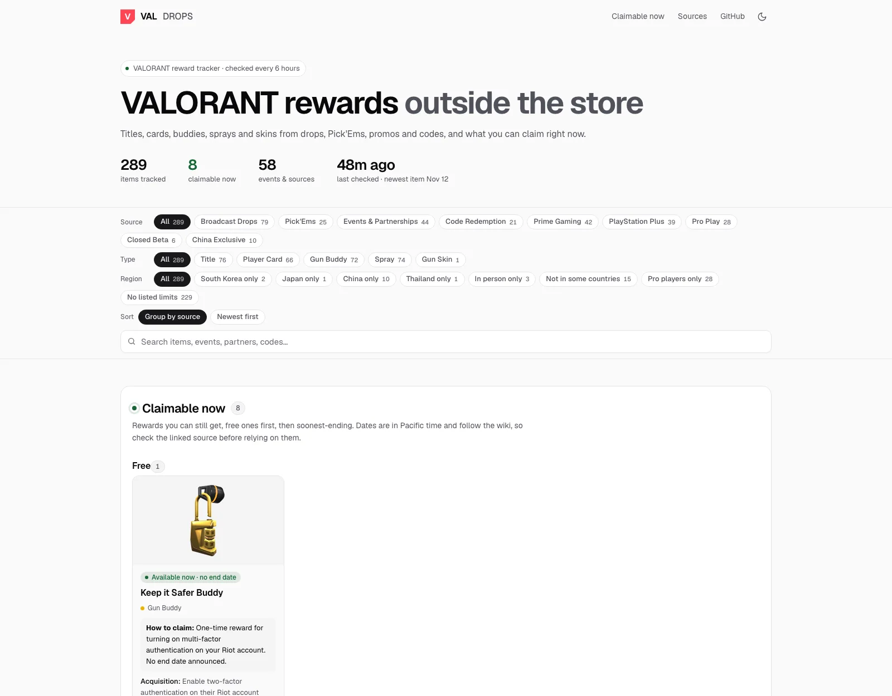
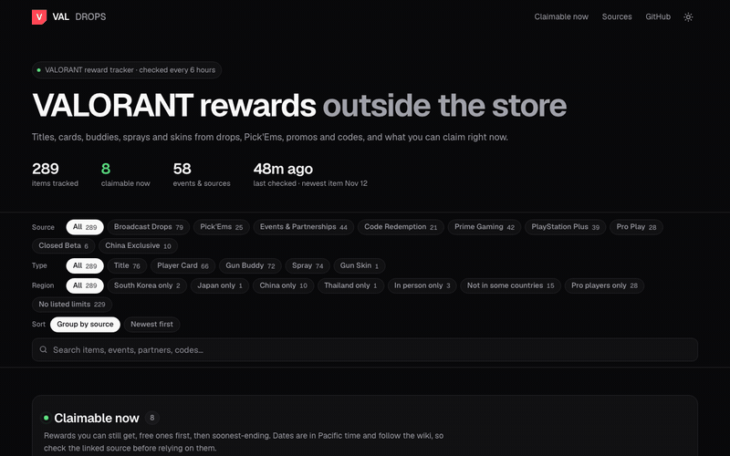

# VAL DROPS

**Every VALORANT title, card, buddy and spray you can't buy in the store, and which ones you can still claim right now.**

### [chillaah.github.io/val-drops](https://chillaah.github.io/val-drops/)

<picture>
  <source media="(prefers-color-scheme: dark)" srcset="docs/images/screenshot-dark.webp">
  
</picture>

## What it does

- **Claimable now:** free rewards first, then ones that need PS Plus, Prime or a partner offer, each with a countdown and how to claim it.
- **Everything else, searchable:** nearly 300 items from broadcast drops, Pick'Ems, challenge events, partner promos, codes, Prime Gaming, PS Plus, pro play and Closed Beta.
- **One-click codes**, region tags, and a link to the original source for every item.
- **Free JSON API** and **Discord alerts** for your own server.

## Use the data

Everything is published as JSON, with no key needed:

**https://chillaah.github.io/val-drops/data/items.json**

Please credit the VALORANT Wiki and link back to the site. The schema is in [docs/data.md](docs/data.md#public-json).

## Get alerts in your Discord server

A small workflow in a private GitHub repo of yours checks for new rewards every 3 hours and posts them to your channel. It's free and takes about 5 minutes to set up: [docs/discord-alerts.md](docs/discord-alerts.md).

## How it works

Every 6 hours a GitHub Actions job scrapes the community-run [VALORANT Wiki](https://wiki.playvalorant.com/en-us/), checks the result and redeploys the static site. If a scrape looks broken, or an edit looks like vandalism (a changed code, a new link domain), the site keeps its last good data until it's reviewed. No framework, no dependencies, no tracking.

More: [features, data and sources](docs/data.md) · [development, pipeline and workflows](docs/development.md)

## Contributing

Missing an item? [Open an issue](https://github.com/chillaah/val-drops/issues/new/choose) with its name and a link. Code changes go in pull requests to `development`; see [docs/development.md](docs/development.md).

## License

Code is [MIT](LICENSE) ([NOTICE](NOTICE) says what that covers). Item data comes from the VALORANT Wiki under [CC BY-SA 3.0](https://creativecommons.org/licenses/by-sa/3.0/). Fonts are Geist and Geist Mono under the [SIL Open Font License](site/assets/fonts/OFL.txt).

This is a fan project and isn't affiliated with or endorsed by Riot Games. VALORANT and all related names, images and assets are trademarks or property of Riot Games, Inc.
