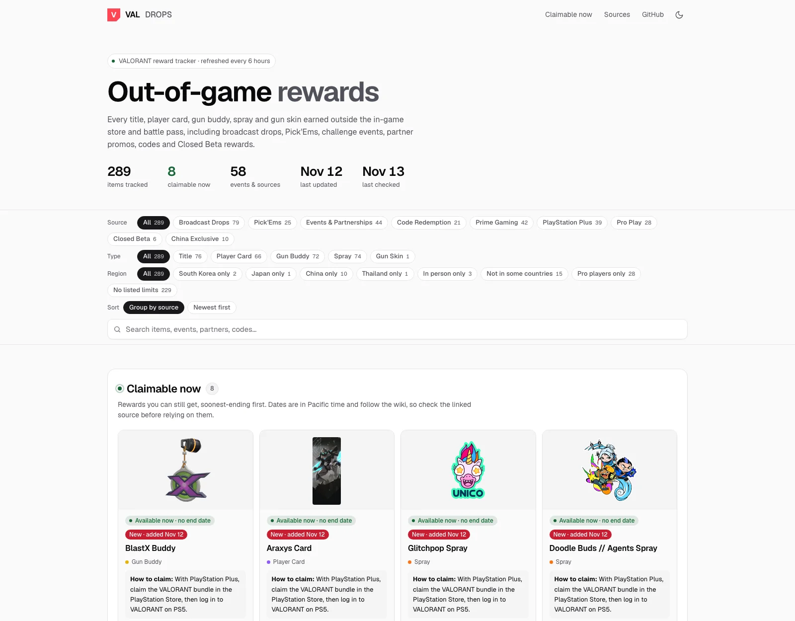

<div align="center">

# VALORANT Out-of-Game Rewards

**Every VALORANT cosmetic you can't buy in the store or unlock from a battle pass, tracked on one page.**

Broadcast drops · Pick'Ems · Challenge events · Brand partnerships · Code redemptions · Prime Gaming · PS+ · Pro play · Closed Beta · China exclusives

[](https://github.com/chillaah/val-drops/actions/workflows/deploy.yml)
[](https://github.com/chillaah/val-drops/actions/workflows/update-data.yml)
[](https://github.com/chillaah/val-drops/actions/workflows/ci.yml)
[](LICENSE)

### [chillaah.github.io/val-drops](https://chillaah.github.io/val-drops/)

<picture>
  <source media="(prefers-color-scheme: dark)" srcset="docs/screenshot-dark.webp">
  
</picture>

</div>

---

## Contents

- [Features](#features)
- [What's tracked](#whats-tracked)
- [Public data](#public-data)
- [Get alerts in your Discord server](#get-alerts-in-your-discord-server)
- [Sources and accuracy](#sources-and-accuracy)
- [How it stays up to date](#how-it-stays-up-to-date)
- [Quality](#quality)
- [Development](#development)
- [Releases and workflows](#releases-and-workflows)
- [License](#license)

## Features

- **Claimable now.** Rewards you can still get, soonest-ending first, each with a countdown and a "how to claim" line. Upcoming rewards and public codes that may still work are listed too.
- **Search and filters.** Search names, events, partners and codes. Filter by source, item type and region.
- **Item pages.** Click any card for a larger image (plus the wide banner for player cards) and a shareable link such as [`?item=slime-mosh-buddy`](https://chillaah.github.io/val-drops/?item=slime-mosh-buddy).
- **Redemption codes.** Every public code has a Copy button. Expired codes, and codes for Riot's old redemption site, are struck through.
- **Region tags.** Items with a stated restriction (South Korea only, Japan only, China only, in person only, not available in some countries) are tagged. Tags only come from what the source says.
- **One card per item.** An item you can get in several ways, like Slime Mosh (a Twitch drop and a Coinbase reward), appears once with an "Also from" list.
- **Recently added and timeline.** Items first seen in the last 30 days that can be claimed now or soon get their own section (old items the wiki only just listed don't count), and [`?sort=newest`](https://chillaah.github.io/val-drops/?sort=newest) shows everything month by month.
- **Light and dark themes.** Follows your system setting until you pick one with the toggle in the header.
- **Discord alerts.** New items, and items whose claim window just opened, can be posted to a Discord channel automatically ([setup](#discord-notifications)). Other servers can get the same alerts with one small workflow file ([how](#get-alerts-in-your-discord-server)).
- **Event end times.** Drops that end with an event's final go offline a couple of hours after it, not at midnight. The build reads the grand final's scheduled start from the [official schedule](https://valorantesports.com) and sets the end to that + a full best-of-five (about 6¼ hours) + 2 hours for co-streamers. Each event needs one line in `events` in [`data/curated.json`](data/curated.json) with its tournament id. Without that line, or if the page can't be read, Drops from an event end at midnight in the host city. (vlr.gg has actual map times, but its terms forbid scripted access.)
- **Co-streamer channels.** For co-streamer Drops, "How to claim" links the participating Twitch channels, copied by hand into `channels` in [`data/curated.json`](data/curated.json) from Twitch's Drops page (Twitch has no public API for them).

## What's tracked

Every **title, player card, gun buddy, spray and gun skin** earned outside the game's usual store, battle pass and agent progression.

| Source | Examples |
|---|---|
| **Broadcast Drops** | VCT Masters, Champions and Game Changers Twitch and Kick drops, co-streamer titles, Shotcall extension rewards, Red Bull Home Ground, Arcane premieres |
| **Pick'Ems** | Per tournament: participation title or spray, top 50% and top 20% buddies with the points needed, pick windows, and the 100% Title |
| **Events & Partnerships** | Challenge events on Riot's FTW site (Alpha vs. Omega, Frag or Die, Night Queue, MAHASONGKRAN), Coinbase, ExpressVPN, Verizon, Xbox Game Pass, merch figure codes, watch parties, RiotX Arcane |
| **Code Redemption** | Public codes from Riot (Pride cards, community challenges) |
| **Prime Gaming** | Monthly Prime Gaming drops from 2020 to 2024, including the Wayfinder Shorty skin |
| **PlayStation Plus** | Rotating PS+ member bundles, dated by month from each bundle's start until the next one |
| **Pro Play** | Tournament winner buddies and titles given to pros, tagged "Pro players only" |
| **Closed Beta** | The 2020 Closed Beta reward pass, entered through Twitch drops (items removed at launch are left out) |
| **China Exclusive** | Items only obtainable on the China version of VALORANT, tagged "China only" and not posted to Discord |

## Public data

All items are published as JSON, updated with the site:

**https://chillaah.github.io/val-drops/data/items.json**

Use it for Discord bots, trackers, spreadsheets or anything else. No key, no rate limit beyond GitHub Pages' own. Please credit the VALORANT Wiki and link back to this site (the text is CC BY-SA 3.0, see `license` in the file).

```jsonc
{
  "schemaVersion": 1,          // bumped only if a field is renamed or removed
  "generated": "2026-11-02T05:19:10.153Z",
  "count": 285,
  "items": [
    {
      "slug": "slime-mosh-buddy",            // stable id, also the site link: ?item=<slug>
      "url": "https://chillaah.github.io/val-drops/?item=slime-mosh-buddy",
      "name": "Slime Mosh Buddy",
      "type": "Gun Buddy",                   // Title, Player Card, Gun Buddy, Spray, Gun Skin
      "category": "Broadcast Drops",         // where it came from (see "What's tracked")
      "group": "...",                        // event or campaign
      "image": "https://...webp",            // full URLs; imageLarge and imageWide when available
      "period": { "start": "2026-07-24", "end": "2026-07-24" },  // plus "tz" and "endsAt" for some events
      "codes": [{ "code": "...", "expires": "2023-12-31", "defunct": false }],
      "regions": [],                         // stated restrictions, e.g. "South Korea only"
      "sources": [{ "url": "...", "label": "...", "official": true }],
      "alsoFrom": [],                        // other ways to get the same item
      "firstSeen": "2026-10-28"              // when the site first listed it (null for the first build)
    }
  ]
}
```

Fields can be `null` when the source doesn't say. New fields may be added at any time without a version bump.

## Get alerts in your Discord server

Want new rewards posted in your own server? You don't need to copy this project. A small workflow in a GitHub repo of yours reads the site's [public data](#public-data) every 3 hours and posts anything new to your channel. It's free.

1. **Make a webhook.** In Discord, open **Server Settings → Integrations → Webhooks → New Webhook**, pick the channel and click **Copy Webhook URL**.
2. **Make a repo.** On GitHub, create a new **private** repository. Any name works, for example `val-drops-alerts`.
3. **Add the webhook as a secret.** In that repo, open **Settings → Secrets and variables → Actions → New repository secret**. Name it `DISCORD_WEBHOOK_URL` and paste the URL.
4. **Add the workflow.** Create the file `.github/workflows/val-drops.yml` with the contents of [`examples/discord-alerts.yml`](examples/discord-alerts.yml).
5. **Run it once.** Open the **Actions** tab, pick **VAL Drops alerts** and click **Run workflow**. A "VAL Drops alerts are set up" message appears in your channel. From then on, new rewards are posted as they're found.

Good to know:
- **Use a private repo.** GitHub turns off scheduled workflows in public repos with no activity for 60 days. Each run takes well under a minute, far inside the free Actions allowance.
- **What gets posted:** the same items as this project's own alerts. That means new rewards you can claim now or soon, and rewards whose claim window just opened. Items you can't claim (ended, China only, unconfirmed dates) are left out.
- **Flood guard:** more than 10 new items at once are posted as one summary. If the list suddenly shrinks, nothing is posted.
- **To stop alerts,** delete the webhook in Discord or disable the workflow.

### For the maintainer: pausing alerts in other servers

Followers post whatever the live `data/items.json` contains. If production publishes wrong items, set `"paused": true` in [`data/alerts.json`](data/alerts.json) and deploy. Followers then post nothing, and they don't mark anything as seen. Fix the data, set it back to `false`, and the next run compares against the list from before the pause, so only the correct changes go out. The pause doesn't affect this repo's own Discord alerts. Messages that were already posted can't be removed from other servers.

## Sources and accuracy

- Item data and images come from the **[VALORANT Wiki](https://wiki.playvalorant.com/en-us/)** through its MediaWiki API. The wiki is community-edited and run by Weird Gloop. **Riot doesn't run it.**
- Each item also links to the **primary source** the wiki cites for it, where there is one: VALORANT Esports articles, PlayVALORANT news, Riot Support, official Riot/VCT social posts, or the partner's campaign page. Riot-owned links are marked ✓, matched on the whole hostname so a look-alike domain can't get the mark.
- [`data/curated.json`](data/curated.json) holds items the wiki doesn't list yet, such as the ExpressVPN × VCT rewards. Every entry there must cite an official page. Its `dates` list fills in claim windows the wiki leaves out. A date that comes from leaks, game files or an estimate gets an `unconfirmed` reason: the item shows an "Unconfirmed date" badge with that reason, and stays out of Recently added and the Discord alerts. Comments and replies are never used as a source.
- Claim dates follow the wiki and are in Pacific time. The site says so next to them and links the source to check. Notes the wiki keeps in tooltips, such as a claim window that was cut short, are shown next to the dates.

**Wiki pages read:** [Broadcast Rewards](https://wiki.playvalorant.com/en-us/Broadcast_Rewards), [Prime Gaming Drops](https://wiki.playvalorant.com/en-us/Prime_Gaming_Drops), [VALORANT X PS+ Bundles](https://wiki.playvalorant.com/en-us/VALORANT_X_PS%2B_Bundles), [Closed Beta](https://wiki.playvalorant.com/en-us/Closed_Beta), [Pick'Ems](https://wiki.playvalorant.com/en-us/Pick'Ems), the two Conflict event pages, and the out-of-game sections of [Sprays](https://wiki.playvalorant.com/en-us/Sprays), [Buddies](https://wiki.playvalorant.com/en-us/Buddies), [Player Cards](https://wiki.playvalorant.com/en-us/Player_Cards) and [Player Titles](https://wiki.playvalorant.com/en-us/Player_Titles) (Channel Drops, Shotcall Extension, Challenge Events, Code Redemption, Pick'Ems, Prime Gaming Drops, Pro play, Miscellaneous, China-Exclusive).

**Left out on purpose:** store, battle pass, agent and Premier rewards; items the wiki lists as unobtainable (in the game files but never handed out); Closed Beta items that were removed from every account at launch; and Radianite Points.

## How it stays up to date

```
 every 6 hours      ┌───────────────────────┐   data-only commit   ┌────────────┐
 (cron) ──────────▶ │ update-data workflow  │ ───────────────────▶ │ production │ ──▶ GitHub Pages
                    │ scrape → check → save │                      └─────┬──────┘
                    └───────────────────────┘                            │ merged back
                                                                   ┌─────▼───────┐
                                                                   │ development │
                                                                   └─────────────┘
```

Each run:

1. Scrapes the wiki into `data/items.js` and saves any new images.
2. Checks the result. The scraper fails if a wiki page it reads suddenly yields no items (a renamed or restructured page), and `scripts/check-data.mjs` requires at least 200 items, no more than a 10% drop from the previous run, required fields and unique slugs. **If a wiki change breaks the scraper, the run fails and the live site keeps its last good data.**
   It also holds back the kinds of edit a wiki vandal would make: a changed code on an existing item, or a link to a site the data has never linked before. Check those on the wiki, then rerun **Update data** with **approve** ticked to publish them.
3. Commits to `production` only if something changed, which redeploys the site.
4. Posts new items, and items whose claim window opened since the last successful run, to Discord, then merges `production` back into `development`.

New rewards usually reach the wiki within hours of Riot announcing them. They appear on the site at the next run, or right away if you start **Update data** from the Actions tab.

## Quality

| | |
|---|---|
| **Performance** | Static HTML, CSS and JavaScript, with no framework and no runtime dependencies. Images are lossless WebP at display size, and fonts are self-hosted subsets. Layout shift on a cold load is close to zero. |
| **Accessibility** | Text meets WCAG AA contrast (4.5:1) in both themes. Cards and the item dialog work with the keyboard, and animations are off for people who prefer reduced motion. |
| **Without JavaScript** | `index.html` contains a pre-rendered list of every item, so search engines and visitors without JavaScript still get the full list. |
| **Privacy and security** | No analytics, cookies or third-party requests. A Content Security Policy allows only this site, plus wiki images as a fallback if a download failed. Workflows use least-privilege permissions and GitHub Actions pinned to commit SHAs, kept current by Dependabot. |
| **Sharing** | Open Graph and Twitter card tags, a 1200×630 preview image, `robots.txt`, `sitemap.xml` and structured data. |

## Development

### Requirements

- Node 18 or newer. There are no npm dependencies.
- Optional: the `webp` tools (`brew install webp` or `apt install webp`) to save images as WebP. Without them the build still works and keeps the wiki's PNG and GIF files.

### Commands

```sh
npm run build   # scrape the wiki into data/items.js, save images into img/, prerender index.html
npm run serve   # serve the site at http://localhost:8080
```

`node scripts/build-data.mjs --no-images` skips image downloads and uses wiki image URLs instead. That's faster, and it's what CI runs.

### How images are stored

Thumbnails are requested from the wiki at display size (within 256×288) and saved as lossless WebP, so they look the same as the wiki's images at about a quarter of the size. The item view's 600px image (`*_600.webp`) and player-card banners (`*_Wide.webp`) are saved the same way and load only when an item is opened. Images that no item uses any more are deleted from `img/`.

### Project layout

```
index.html, app.js, styles.css   the site (no framework, no build step)
theme.js                         light/dark theme, loaded in <head> so there's no flash
404.html                         not-found page (GitHub Pages serves it for any missing path)
robots.txt, sitemap.xml          for search engines
assets/                          favicon, touch icon, og.png preview image, no-JS stylesheet
assets/fonts/                    self-hosted Geist and Geist Mono (SIL OFL, see OFL.txt)
data/items.js                    generated item data (window.VAL_DROPS)
data/items.json                  the same data as public JSON (see Public data)
data/curated.json                hand-added items the wiki doesn't have yet
data/alerts.json                 pause switch for other servers' Discord alerts
examples/discord-alerts.yml      workflow other servers copy to get Discord alerts
img/                             item images saved from the wiki
docs/                            README screenshots (not deployed)
scripts/build-data.mjs           wiki scraper
scripts/export-json.mjs          writes data/items.json
scripts/check-data.mjs           blocks publishing if a scrape looks broken or an edit needs review
scripts/prerender.mjs            writes the plain item list into index.html
scripts/event-times.mjs          end times for event Drops from the official schedule
scripts/notify-discord.mjs       posts new items to a Discord webhook
scripts/og-image.html            source for assets/og.png (screenshot #og at 1200×630)
.github/workflows/               CI, data updates, deploys
```

### Adding a missing item

Not a developer? [Open an issue](https://github.com/chillaah/val-drops/issues/new/choose) with the item name and a link, and it'll be added.

1. Add an entry to [`data/curated.json`](data/curated.json) with `name`, `type`, `category`, `group`, `file` (the wiki image file name) and `refs` (official links).
2. Run `npm run build` and check the result locally.
3. Open a pull request into `development`.

## Releases and workflows

| Branch | Purpose |
|---|---|
| `development` | Default branch. All work and pull requests go here. |
| `production` | The live site. Every push deploys to GitHub Pages. The data bot commits new items here and merges them back into `development`. |

**To release,** open a pull request from `development` into `production` and merge it.

| Workflow | Runs | What it does |
|---|---|---|
| [CI](.github/workflows/ci.yml) | Pushes to `development`, pull requests | Syntax-checks the scripts, runs the scraper and the data check, and confirms the site files exist. Commits nothing. |
| [Update data](.github/workflows/update-data.yml) | Every 6 hours, or manually | Scrapes, checks and commits new data to `production`, posts to Discord, merges back into `development`. Run it manually with **approve** to publish changes the check held for review. |
| [Deploy](.github/workflows/deploy.yml) | Pushes to `production`, or manually | Publishes the site to GitHub Pages. |
| [Discord test](.github/workflows/discord-test.yml) | Manually | Shows which channel the webhook posts to and can send one test message. |
| [Discord alerts for other servers](.github/workflows/discord-follow.yml) | Called from other people's repos | Posts new items from the live `data/items.json` to their own Discord channel. See [Get alerts in your Discord server](#get-alerts-in-your-discord-server). |

### Discord notifications

When the update job finds new items, or an item's claim window has opened since the last successful run (like a Drop that starts on a set day), it posts each one to a Discord channel with its image, dates or how to get it, primary source, and a link to the item on the site. Only items claimable now or soon are posted (the same rule as "Recently added"), so old or undated items the wiki only just listed China-only items and items with an unconfirmed date are left out, and an item the wiki only moved to another section doesn't count as new. Image links point at the exact commit, so they keep working after later runs convert or prune images.

1. In Discord, open **Server Settings → Integrations → Webhooks → New Webhook**, pick the channel and copy the webhook URL.
2. In this repo, add it under **Settings → Secrets and variables → Actions** as `DISCORD_WEBHOOK_URL`.
3. Optional: run the **Discord test** workflow to confirm the channel.

When a co-streamer Drop goes live with no channels listed, or an event's Drops go live with no `events` line for exact end times, a reminder is posted too. Set `DISCORD_ADMIN_WEBHOOK_URL` to send those reminders to a separate (private) channel; without it they go to the main one.

If the secret isn't set, the step is skipped. A run with more than 25 new items posts one summary message instead of flooding the channel. To preview messages without posting, run `PREV_CHECK=<ISO time> node scripts/notify-discord.mjs <old-items.js> data/items.js --dry-run`.

## License

- **Code:** [MIT](LICENSE).
- **Item data** (including `data/items.json`): from the VALORANT Wiki under [CC BY-SA 3.0](https://creativecommons.org/licenses/by-sa/3.0/).
- **Fonts:** Geist and Geist Mono, under the [SIL Open Font License](assets/fonts/OFL.txt).

This is a fan project and isn't affiliated with or endorsed by Riot Games. VALORANT and all related names, images and assets are trademarks or property of Riot Games, Inc.
