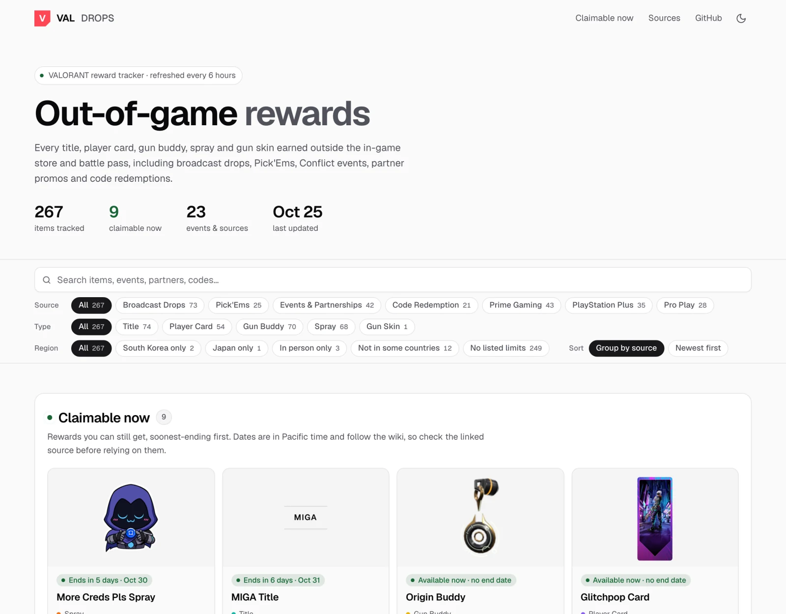

<div align="center">

# VALORANT Out-of-Game Rewards

**Every VALORANT cosmetic you can't buy in the store or unlock from a battle pass, tracked on one page.**

Broadcast drops · Pick'Ems · Conflict events · Brand partnerships · Code redemptions · Prime Gaming · PS+ · Pro play

[](https://github.com/chillaah/val-drops/actions/workflows/deploy.yml)
[](https://github.com/chillaah/val-drops/actions/workflows/update-data.yml)
[](https://github.com/chillaah/val-drops/actions/workflows/ci.yml)
[](LICENSE)

### [chillaah.github.io/val-drops](https://chillaah.github.io/val-drops/)

<picture>
  <source media="(prefers-color-scheme: dark)" srcset="docs/screenshot-dark.webp">
  
</picture>

</div>

---

## Contents

- [Features](#features)
- [What's tracked](#whats-tracked)
- [Sources and accuracy](#sources-and-accuracy)
- [How it stays up to date](#how-it-stays-up-to-date)
- [Quality](#quality)
- [Development](#development)
- [Releases and workflows](#releases-and-workflows)
- [License](#license)

## Features

- **Claimable now.** Rewards you can still get, soonest-ending first, each with a countdown and a "how to claim" line. Upcoming rewards and public codes that may still work are listed too.
- **Search and filters.** Search names, events, partners and codes. Filter by source, item type and region.
- **Item pages.** Click any card for a larger image (plus the wide banner for player cards) and a shareable link such as [`?item=slime-mosh-buddy`](https://chillaah.github.io/val-drops/?item=slime-mosh-buddy).
- **Redemption codes.** Every public code has a Copy button. Expired codes, and codes for Riot's old redemption site, are struck through.
- **Region tags.** Items with a stated restriction (South Korea only, Japan only, in person only, not available in some countries) are tagged. Tags only come from what the source says.
- **One card per item.** An item you can get in several ways, like Slime Mosh (a Twitch drop and a Coinbase reward), appears once with an "Also from" list.
- **Recently added and timeline.** Items first seen in the last 30 days get their own section, and [`?sort=newest`](https://chillaah.github.io/val-drops/?sort=newest) shows everything month by month.
- **Light and dark themes.** Follows your system setting until you pick one with the toggle in the header.
- **Discord alerts.** New items can be posted to a Discord channel automatically ([setup](#discord-notifications)).

## What's tracked

Every **title, player card, gun buddy, spray and gun skin** earned outside the game's usual store, battle pass and agent progression.

| Source | Examples |
|---|---|
| **Broadcast Drops** | VCT Masters, Champions and Game Changers Twitch drops, co-streamer titles, Shotcall extension rewards, Red Bull Home Ground, Arcane premieres |
| **Pick'Ems** | Top 50% and top 20% buddies, Pick'Ems sprays, participation and perfect-picks titles |
| **Events & Partnerships** | Alpha vs. Omega Conflict, Champions Conflict: Frag or Die, Coinbase, ExpressVPN, Verizon, Xbox Game Pass, merch figure codes, watch parties, RiotX Arcane |
| **Code Redemption** | Public codes from Riot (Pride cards, community challenges) |
| **Prime Gaming** | Monthly Prime Gaming drops from 2020 to 2024, including the Wayfinder Shorty skin |
| **PlayStation Plus** | Rotating PS+ member bundles |
| **Pro Play** | Tournament winner buddies and titles given to pros |

## Sources and accuracy

- Item data and images come from the **[VALORANT Wiki](https://wiki.playvalorant.com/en-us/)** through its MediaWiki API. The wiki is community-edited and run by Weird Gloop. **Riot doesn't run it.**
- Each item also links to the **primary source** the wiki cites for it, where there is one: VALORANT Esports articles, PlayVALORANT news, Riot Support, official Riot/VCT social posts, or the partner's campaign page. Riot-owned links are marked ✓.
- [`data/curated.json`](data/curated.json) holds items the wiki doesn't list yet, such as the ExpressVPN × VCT rewards. Every entry there must cite an official page.
- Claim dates follow the wiki and are in Pacific time. The site says so next to them and links the source to check.

## How it stays up to date

```
 every 6 hours      ┌───────────────────────┐   data-only commit   ┌────────────┐
 (cron) ──────────▶ │ update-data workflow  │ ───────────────────▶ │ production │ ──▶ GitHub Pages
                    │ scrape → check → save │                      └─────┬──────┘
                    └───────────────────────┘                            │ merged back
                                                                   ┌─────▼───────┐
                                                                   │ development │
                                                                   └─────────────┘
```

Each run:

1. Scrapes the wiki into `data/items.js` and saves any new images.
2. Checks the result with `scripts/check-data.mjs`: at least 200 items, no more than a 10% drop from the previous run, required fields present, slugs unique. **If a wiki layout change breaks the scraper, the run fails and the live site keeps its last good data.**
3. Commits to `production` only if something changed, which redeploys the site.
4. Posts new items to Discord, then merges `production` back into `development`.

New rewards usually reach the wiki within hours of Riot announcing them. They appear on the site at the next run, or right away if you start **Update data** from the Actions tab.

## Quality

| | |
|---|---|
| **Performance** | Static HTML, CSS and JavaScript, with no framework and no runtime dependencies. Images are lossless WebP at display size, and fonts are self-hosted subsets. Layout shift on a cold load is close to zero. |
| **Accessibility** | Text meets WCAG AA contrast (4.5:1) in both themes. Cards and the item dialog work with the keyboard, and animations are off for people who prefer reduced motion. |
| **Without JavaScript** | `index.html` contains a pre-rendered list of every item, so search engines and visitors without JavaScript still get the full list. |
| **Privacy and security** | No analytics, cookies or third-party requests. A Content Security Policy allows only this site, plus wiki images as a fallback if a download failed. |
| **Sharing** | Open Graph and Twitter card tags, a 1200×630 preview image, `robots.txt`, `sitemap.xml` and structured data. |

## Development

### Requirements

- Node 18 or newer. There are no npm dependencies.
- Optional: the `webp` tools (`brew install webp` or `apt install webp`) to save images as WebP. Without them the build still works and keeps the wiki's PNG and GIF files.

### Commands

```sh
npm run build   # scrape the wiki into data/items.js, save images into img/, prerender index.html
npm run serve   # serve the site at http://localhost:8080
```

`node scripts/build-data.mjs --no-images` skips image downloads and uses wiki image URLs instead. That's faster, and it's what CI runs.

### How images are stored

Thumbnails are requested from the wiki at display size (within 256×288) and saved as lossless WebP, so they look the same as the wiki's images at about a quarter of the size. The item view's 600px image (`*_600.webp`) and player-card banners (`*_Wide.webp`) are saved the same way and load only when an item is opened. Images that no item uses any more are deleted from `img/`.

### Project layout

```
index.html, app.js, styles.css   the site (no framework, no build step)
theme.js                         light/dark theme, loaded in <head> so there's no flash
404.html                         not-found page (GitHub Pages serves it for any missing path)
robots.txt, sitemap.xml          for search engines
assets/                          favicon, touch icon, og.png preview image, no-JS stylesheet
assets/fonts/                    self-hosted Geist and Geist Mono (SIL OFL, see OFL.txt)
data/items.js                    generated item data (window.VAL_DROPS)
data/curated.json                hand-added items the wiki doesn't have yet
img/                             item images saved from the wiki
docs/                            README screenshots (not deployed)
scripts/build-data.mjs           wiki scraper
scripts/check-data.mjs           blocks publishing if a scrape looks broken
scripts/prerender.mjs            writes the plain item list into index.html
scripts/notify-discord.mjs       posts new items to a Discord webhook
scripts/og-image.html            source for assets/og.png (screenshot #og at 1200×630)
.github/workflows/               CI, data updates, deploys
```

### Adding a missing item

1. Add an entry to [`data/curated.json`](data/curated.json) with `name`, `type`, `category`, `group`, `file` (the wiki image file name) and `refs` (official links).
2. Run `npm run build` and check the result locally.
3. Open a pull request into `development`.

## Releases and workflows

| Branch | Purpose |
|---|---|
| `development` | Default branch. All work and pull requests go here. |
| `production` | The live site. Every push deploys to GitHub Pages. The data bot commits new items here and merges them back into `development`. |

**To release,** open a pull request from `development` into `production` and merge it.

| Workflow | Runs | What it does |
|---|---|---|
| [CI](.github/workflows/ci.yml) | Pushes to `development`, pull requests | Syntax-checks the scripts, runs the scraper and the data check, and confirms the site files exist. Commits nothing. |
| [Update data](.github/workflows/update-data.yml) | Every 6 hours, or manually | Scrapes, checks and commits new data to `production`, posts to Discord, merges back into `development`. |
| [Deploy](.github/workflows/deploy.yml) | Pushes to `production`, or manually | Publishes the site to GitHub Pages. |
| [Discord test](.github/workflows/discord-test.yml) | Manually | Shows which channel the webhook posts to and can send one test message. |

### Discord notifications

When the update job finds new items, it posts each one to a Discord channel with its image, dates or how to get it, primary source, and a link to the item on the site.

1. In Discord, open **Server Settings → Integrations → Webhooks → New Webhook**, pick the channel and copy the webhook URL.
2. In this repo, add it under **Settings → Secrets and variables → Actions** as `DISCORD_WEBHOOK_URL`.
3. Optional: run the **Discord test** workflow to confirm the channel.

If the secret isn't set, the step is skipped. A run with more than 25 new items posts one summary message instead of flooding the channel. To preview messages without posting, run `node scripts/notify-discord.mjs <old-items.js> data/items.js --dry-run`.

## License

- **Code:** [MIT](LICENSE).
- **Item data:** from the VALORANT Wiki under [CC BY-SA 3.0](https://creativecommons.org/licenses/by-sa/3.0/).
- **Fonts:** Geist and Geist Mono, under the [SIL Open Font License](assets/fonts/OFL.txt).

This is a fan project and isn't affiliated with or endorsed by Riot Games. VALORANT and all related names, images and assets are trademarks or property of Riot Games, Inc.
